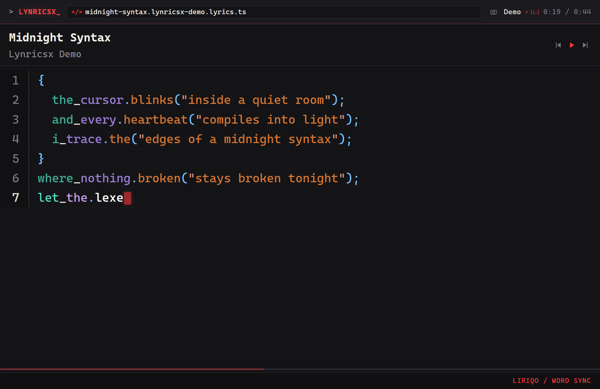
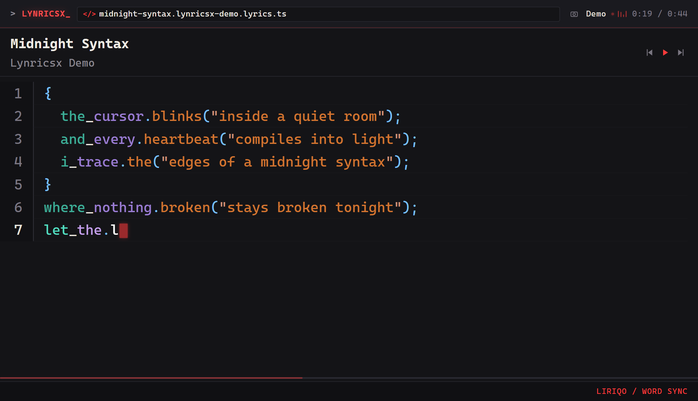
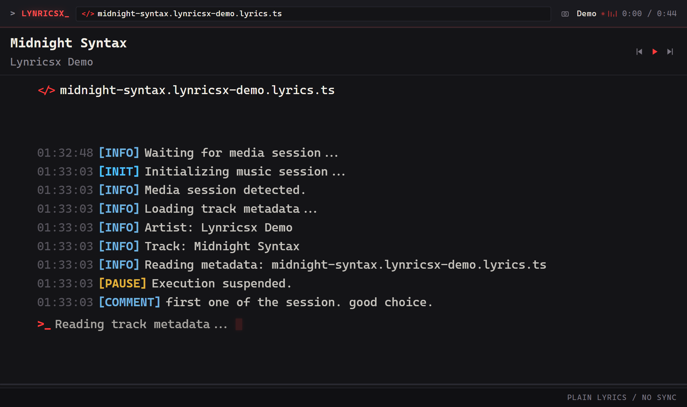
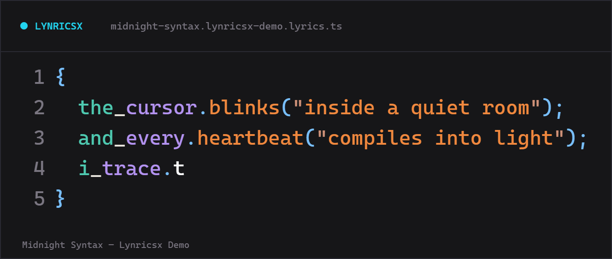
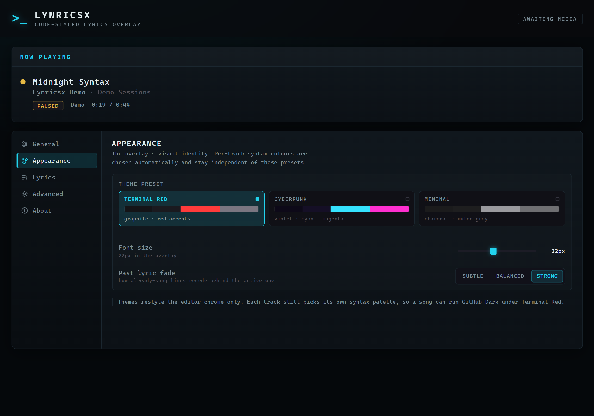

# Lynricsx

**A code-styled lyrics overlay for Windows.** Turn your music into a live coding
experience with real-time lyrics synchronization, syntax highlighting, and an
interactive terminal.

[](https://github.com/AriepHidayat7/Lynricsx/actions/workflows/ci.yml)


Lynricsx shows the **currently playing song** as if it were a source file in a
code editor. It reads the media session through the **Windows Global System
Media Transport Controls (GSMTC)** API, fetches synchronized lyrics from
**LiriQo** and **LRCLIB**, and renders them as syntax-highlighted code where the
word being sung is the token currently being "typed".

Nothing on screen is simulated: every lyric position follows the real playback
clock, and every terminal message is derived from a real application event.

Works with any player that exposes a media session to Windows — Spotify, Apple
Music, YouTube Music in a browser, Windows Media Player, MusicBee, foobar2000,
VLC and others.

## Screenshots

All screenshots show the fictional demo track **“Midnight Syntax” by Lynricsx
Demo**. The lyrics are original content written for this project, and every
image is an unretouched capture of the shipping application.

**Main overlay** — lyrics as syntax-highlighted code, with word-level sync and a
typewriter cursor:



**Composition styles** — one track renders nested blocks and flat statements
side by side:



**Live terminal session** — real event log while lyrics are still loading:



**Code snapshot export** — the PNG the app generates from its own renderer:



**Control panel** — appearance presets, font size and past-lyric fade:



## Features

Every feature below is present in this version.

### Lyrics and synchronization

- **Real-time synchronized lyrics** driven by the playback position.
- **Karaoke word sync** with upcoming / active / sung word states; the fill
  follows the real word timestamps, not CSS durations.
- **Character, word and syllable synchronization.** LiriQo supplies native
  word/syllable timing; when only line timing exists Lynricsx falls back to line
  sync, and the UI reports the level actually obtained — it never claims word
  sync when only line timing was returned.
- **Two providers with a fixed priority:** native word/syllable timing →
  LRCLIB line-synced LRC → LiriQo line-synced LRC → plain lyrics. Requests are
  debounced, de-duplicated, rate-limited client-side and cached on disk.

### Code-style composition

- **Code-style lyric composition.** Each lyric line is emitted as a decorated
  code statement with a gutter, a virtual source tab and syntax colouring.
- **Multiple composition styles:** `flat`, `nested`, `comment` and `hybrid`,
  chosen from a deterministic per-track seed. A song has a dominant style, but
  groups rotate through the others so one track shows several shapes.
- **Syntax highlighting** with a deterministic per-track palette, independent of
  the appearance preset.

### Overlay

- **Typewriter animation** with six cursor styles: block, line, underline, bar,
  hollow and off.
- **Configurable lyric history** (1–20 visible lines, active line included) with
  focused behaviour for the active expression and a configurable past-lyric
  appearance.
- **Dynamic virtual filename** derived from track metadata, e.g.
  `backburner.niki.lyrics.ts` (lowercased, accents folded, punctuation
  hyphenated). Nothing is written to disk.
- **Frameless, always-on-top overlay** with click-through, drag positioning,
  position lock and remembered geometry on scaled or negative-origin monitors.

### Playback

- **Spotify (and any GSMTC player) playback controls** — previous, play/pause
  and next — through Windows GSMTC.
- **Click-to-seek** on a lyric line.
- **Lyric replay** for the current expression.
- **Cinematic track transitions** between two different tracks.

### Live terminal and extras

- **Live Terminal Session:** a boot sequence, track initialisation
  (`New track detected` → `Reading metadata` → `[QUERY]` → `[CACHE]` /
  `[FETCH]` → `[PROCESS]` → `[SUCCESS]` → `[READY]`), transition and playback
  messages, all driven by real events.
- **Easter egg system:** at most one cosmetic aside every four tracks, chosen
  deterministically from the track identity.
- **Ambient code activity:** an animated bar cluster in the header reflecting the
  playback state (not an audio analyser).
- **Code Snapshot PNG export** of the current frame.

### Appearance

- **Three presets** for overlay chrome: `TERMINAL RED`, `CYBERPUNK`, `MINIMAL`.
- **Configurable appearance:** font size, lyric history size, past-lyric
  appearance, typewriter on/off, cursor style.
- **Control panel** with now-playing info, sync status with provider
  attribution, and cache size/clearing.

## Live code execution experience

While there is nothing to render yet, the overlay behaves like a terminal that is
running the song's source file. Every message is derived from a **real**
application event — nothing is simulated or time-delayed.

- **Boot sequence** — runs once per launch (`INIT` / `SUCCESS` / waiting prompt).
  It never blocks lyrics: an already-playing track is processed immediately.
- **Track initialisation** — `New track detected` → `Reading metadata: <file>` →
  the provider the backend actually queries (`[QUERY] Querying LiriQo...`), a
  `[CACHE] Restoring cached lyrics...` on a cache hit, then
  `[FETCH]`/`[PROCESS]`/`[SUCCESS]`/`[READY]`.
- **Track transitions** — a real identity change emits
  `Releasing previous track context...` before the new file opens. Position
  ticks and seeks never trigger it.
- **Virtual source tab** — each track gets a VS Code-style tab derived from its
  metadata, e.g. `backburner.niki.lyrics.ts` (lowercased, accents folded,
  punctuation hyphenated). Nothing is written to disk.
- **Playback feedback** — `[EXEC]`, `[PAUSE]`, `[SEEK]`, `[LOAD]`, `[STOP]`,
  `[WARN]` messages, driven by real state transitions and a backend seek
  counter.
- **Activity indicator** — a small animated bar cluster in the header. It
  reflects the playback *state* only; it is not an audio analyser.
- **Easter eggs** — at most one cosmetic aside every four tracks, chosen
  deterministically from the track identity.

Terminal status colours (`INIT`/`INFO`/`PROCESS`/`SUCCESS`/`WARNING`/`ERROR`) are
a separate palette scoped to `.term-*`, so they never touch the per-track lyric
syntax colours. Three toggles live under **Advanced**: *Terminal effects*,
*Terminal activity*, *Easter eggs*.

## Appearance presets vs. syntax palettes
Two independent colour systems drive the overlay:

| System | Selected by | Controls |
| --- | --- | --- |
| **Appearance preset** | Settings → Appearance | Overlay background, gutters, header/footer chrome, borders, brand + accent colour, song title, comment grey |
| **Syntax palette** | Deterministic per-track seed | Hue of the generated lyric code: head identifier, member after the dot, quoted argument, punctuation |

A song rendered with the GitHub Dark palette can be shown with the Cyberpunk
preset, and switching presets never changes a track's palette.

## Project structure

```
Lynricsx/
├─ src/                        # React + TypeScript frontend
│  ├─ main.tsx                 # control-panel entry (index.html)
│  ├─ overlay-main.tsx         # overlay entry (overlay.html)
│  ├─ App.tsx                  # control-panel UI
│  ├─ components/              # Overlay, TerminalView, SettingsPanel, controls…
│  ├─ lib/                     # pure logic (no React): codeview, sync, compose,
│  │                           #   seek, replay, history, snapshot, terminal…
│  ├─ styles/                  # app.css, overlay.css, terminal.css
│  └─ types.ts                 # shared TS types (mirror Rust serde output)
├─ src-tauri/                  # Rust backend
│  ├─ src/
│  │  ├─ main.rs
│  │  ├─ lib.rs                # window mgmt, commands, IPC surface
│  │  ├─ gsmtc.rs              # WinRT GSMTC wrapper (types + events)
│  │  ├─ media_worker.rs       # owned MTA thread + watch channel
│  │  ├─ autostart.rs          # start-with-Windows entry
│  │  ├─ diag.rs               # diagnostic logging
│  │  ├─ settings.rs           # persisted settings + overlay payloads
│  │  └─ lyrics/
│  │     ├─ mod.rs             # LyricsProvider trait + result types
│  │     ├─ liriqo.rs          # LiriQo provider (word/syllable timing)
│  │     ├─ lrclib.rs          # LRCLIB provider
│  │     ├─ selection.rs       # provider priority + matching
│  │     ├─ lrc.rs             # LRC parser
│  │     └─ cache.rs           # in-memory + on-disk cache
│  ├─ capabilities/default.json
│  ├─ tauri.conf.json
│  └─ Cargo.toml
├─ docs/                       # architecture, building, configuration, notices
├─ tests/                      # node:test suites (import TS sources directly)
├─ scripts/
│  ├─ gen-icon.js              # generates app-icon.png (no deps)
│  └─ with-tools.mjs           # locates MinGW windres for the GNU build
├─ index.html                  # control panel HTML entry
└─ overlay.html                # overlay HTML entry
```

## Requirements

- **Windows 10 (version 1809 or newer) or Windows 11**, 64-bit.
- **WebView2 runtime.** Preinstalled on Windows 11 and current Windows 10; the
  installer expects it to be present.
- A player that publishes a **media session** to Windows. Players that do not
  expose GSMTC cannot provide lyrics to the overlay.

No account, API key or configuration file is required.

### Platform support

Lynricsx is a **Windows-only** application.

**macOS and Linux are not currently supported and do not build.** The backend
binds Windows-specific APIs directly — GSMTC (`Windows.Media.Control`), the Win32
registry for autostart, and the WinRT media session — through the `windows`
crate. There is no cross-platform abstraction layer, so there is no
configuration or flag that makes this project run on another operating system.

## Installation

1. Download the latest `Lynricsx_<version>_x64-setup.exe` from the
   [Releases page](https://github.com/AriepHidayat7/Lynricsx/releases).
2. Run it. The installer is **per-user** and needs no administrator rights.
3. Launch **Lynricsx** from the Start menu. The overlay appears in the
   bottom-left corner of your primary monitor on first run.

> Until the first release is published, build from source — see below.

## Build from source

Full details and verified commands are in [docs/BUILDING.md](docs/BUILDING.md).

```powershell
# Prerequisites: Node 18+, rustup + GNU toolchain, MinGW windres (see docs)
npm install
npm run tauri:dev      # run the app
npm run tauri:build    # produce the NSIS installer
```

The installer is written to
`src-tauri\target\release\bundle\nsis\Lynricsx_0.1.0_x64-setup.exe`.

## Documentation

| Document | Contents |
| --- | --- |
| [docs/ARCHITECTURE.md](docs/ARCHITECTURE.md) | Process/window model, backend and frontend layout, rendering pipeline |
| [docs/BUILDING.md](docs/BUILDING.md) | Prerequisites, build commands, toolchains, known test issue |
| [docs/CONFIGURATION.md](docs/CONFIGURATION.md) | Settings file reference, storage paths, network access |
| [docs/SCREENSHOTS.md](docs/SCREENSHOTS.md) | How the screenshots are produced and regenerated |
| [docs/THIRD-PARTY-NOTICES.md](docs/THIRD-PARTY-NOTICES.md) | Dependency licenses and attributions |
| [CONTRIBUTING.md](CONTRIBUTING.md) | Code conventions, tests, pull requests |
| [SECURITY.md](SECURITY.md) | Reporting a vulnerability |
| [CHANGELOG.md](CHANGELOG.md) | Release history |

## Testing

```powershell
npm test                                  # 302 frontend tests (node --test)
npx tsc --noEmit                          # type check
cd src-tauri; cargo check --tests         # type-check backend incl. tests
```

Running the **Rust unit tests** currently requires the MSVC toolchain:

```powershell
cd src-tauri
cargo +stable-x86_64-pc-windows-msvc test --lib
```

On the GNU target the test binary fails to load before any test runs
(`0xC0000139`), because Tauri pulls in `windows` 0.62 while the project depends
on `windows` 0.58. See
[docs/BUILDING.md](docs/BUILDING.md#known-issue-cargo-test-on-the-gnu-target).

## Troubleshooting

**The overlay says "NO MEDIA DETECTED".**
GSMTC is opt-in. Start playback in the player first, then open Lynricsx (or
start playback again). Players that never publish a media session cannot be
used — this is a Windows limitation, not a Lynricsx one.

**Lyrics appear, but they are not synced.**
The track has no timed lyrics. Lynricsx reports the sync level it actually got —
`PLAIN LYRICS / NO SYNC` means only untimed lyrics were found. Browser players
often report no timeline at all, which rules out position tracking.

**Lyrics are out of sync with the audio.**
Some players report an approximate position. Seeking once usually resets it. If
it persists, the provider's timestamps are likely off for that track.

**"Waiting for media session…" never resolves.**
Another app may be holding the dominant media session. Stop playback there, or
check that the player is actually visible to Windows (Windows volume flyout
should show the track).

**The overlay is gone / I cannot click it.**
It may be behind other windows or in click-through mode. Re-enable it from the
control panel: **General → overlay visibility**, and clear **click-through**.
Use **lock position** only after placing it.

**Nothing builds: `windres` not found.**
Install MinGW binutils (`winget install BrechtSanders.WinLibs.POSIX.UCRT`). The
build wrapper searches `%LOCALAPPDATA%\Microsoft\WinGet\Packages\*\mingw64\bin`,
`C:\Program Files\WinLibs`, `C:\WinLibs` and `C:\mingw64`.

**Media detection is failing and I need details.**
Check `%LOCALAPPDATA%\Lynricsx\logs\gsmtc.log` and include the relevant part when
reporting the issue.

## How lyric synchronization works

1. The Rust media worker samples the GSMTC session (position + duration) every
   250 ms. A snapshot is published on any track/state change, on every position
   second while playing, **and immediately when a seek is detected** — a jump in
   the reported position that the elapsed wall clock cannot explain. It also
   subscribes to the session's `PlaybackInfoChanged` event (play/pause *and*
   seek), re-arming the subscription whenever the dominant session changes.
2. The overlay extrapolates position from the last sample using the wall clock
   (`positionMs + (now - sampledAtMs)`), clamped to duration; while paused the
   reported position is used as-is.
3. A `requestAnimationFrame` loop computes the active line and active word via
   binary search and only re-renders React when line/word state actually changes.
   A backward jump, or a forward jump larger than 1.5 s, is treated as a seek and
   applied on the next frame in either direction — scrubbing never waits for a
   pause/resume.
4. The active word is colored `upcoming` / `active` / `sung` and its fill
   proportion follows the real word timestamp (not a CSS animation duration).
5. Completed expressions stay on screen up to the configured **Lyric history**
   size (1–20 lines, active line included) and recede according to the *Past
   lyrics appearance* setting; the active line stays fully readable and wraps
   responsively to the overlay width.

## Notes / limitations

- Overlay X/Y are **logical** screen coordinates. They are converted to physical
  pixels with the active monitor's DPI factor, and a corner anchor is resolved
  against that monitor's work area (taskbar excluded), so first-launch
  placement also works on scaled and negative-origin (left/top) monitors. The
  Settings UI deliberately exposes no manual position controls; the overlay is
  moved by dragging, and its position is still persisted.
- Positions are persisted in `settings.json`. Settings files written by older
  builds that still contain removed keys (`opacity`, `scanlines`,
  `scanlineIntensity`, …) load fine: unknown keys are ignored.
- The bundle identifier (`com.redlyrics.app`) and therefore the settings and
  cache directories are unchanged by the Lynricsx rename, so upgrading keeps
  existing data.
- GSMTC is opt-in for players; if a player does not publish a
  `SystemMediaTransportControls` session, Lynricsx shows "NO MEDIA DETECTED".
- Some players (especially web browsers) do not report a timeline; in that case
  synchronized lyrics fall back to plain (untimed) lyrics or a static view.
- LRCLIB is a free service; Lynricsx identifies itself with a User-Agent and
  applies client-side rate limiting + caching.
- LiriQo word/syllable timing depends on the providers it aggregates; if no
  native word data exists for a track, Lynricsx falls back to line/plain sync
  and reports the actual sync level (never "word sync" when only line timing
  was returned).

## Acknowledgments

Lynricsx would not exist without these projects:

- **[Tauri](https://tauri.app)** — the Rust application shell and bundler.
- **[React](https://react.dev)** and **[Vite](https://vite.dev)** — the UI and
  build pipeline.
- **[windows-rs](https://github.com/microsoft/windows-rs)** — the Rust bindings
  behind Windows GSMTC integration.
- **[LiriQo](https://github.com/AlFarrizi-Studio/LiriQo)** — the preferred lyric
  provider, and the source of native word/syllable timing.
- **[LRCLIB](https://lrclib.net)** — the line-synced fallback provider.

Lyrics displayed by Lynricsx belong to their respective rights holders and are
fetched at runtime; the project does not ship or redistribute any lyric data.
See [docs/THIRD-PARTY-NOTICES.md](docs/THIRD-PARTY-NOTICES.md) for the full
dependency and license list.

## License

Lynricsx is released under the **MIT License**.

```
MIT License

Copyright (c) 2026 Ahmad Arief Hidayat
```

See [LICENSE](LICENSE) for the full text. You are free to use, copy, modify,
merge, publish, distribute, sublicense and sell copies of the software, provided
the copyright notice and permission notice are included.

Third-party dependencies and lyric providers keep their own licenses — see
[docs/THIRD-PARTY-NOTICES.md](docs/THIRD-PARTY-NOTICES.md). Nothing in this
project claims ownership of them.

## Contributing

Bug reports and pull requests are welcome — see
[CONTRIBUTING.md](CONTRIBUTING.md) and [CODE_OF_CONDUCT.md](CODE_OF_CONDUCT.md).
For security issues, follow [SECURITY.md](SECURITY.md).
